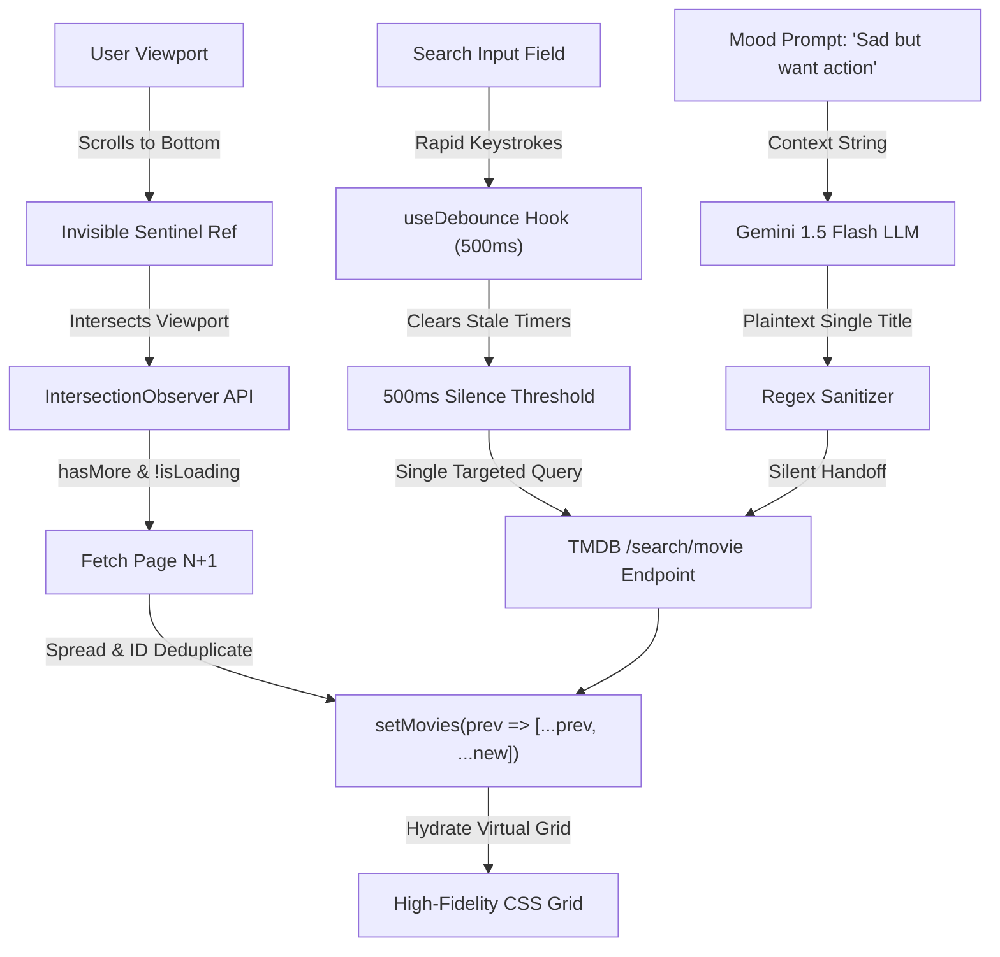

# Cine-Stream 🎬 | Netflix-Lite Media Discovery SPA

[](https://vitejs.dev/)
[](https://react.dev/)
[](https://www.themoviedb.org/)
[](https://aistudio.google.com/)

A high-performance, Netflix-inspired Single Page Application (SPA) consuming **The Movie Database (TMDB) REST API** with on-demand data hydration (Infinite Scroll), request throttling (Debouncing), offline state persistence (Favorites), and contextual AI mood curation (Google Gemini).

---

## 🏗️ Architecture & Engineering Overview



---

## 🎯 Sprint Feature Matrix

### Phase 1: Base Architecture & API Consumption (P0)
- **High-Fidelity CSS Grid**: Responsive media grid displaying poster, title, release year, and star rating with dynamic color badges (Green for 7.5+, Orange for 6.0–7.4, Red for <6.0).
- **Popular Movies Discovery**: Consumes the TMDB `/movie/popular` REST v3 endpoint with pagination support.
- **Search Component**: Consumes TMDB `/search/movie` with automatic query execution and empty-state fallback to popular movies.
- **Resilience Layer**: Out-of-the-box support for the **OMDB API** as an alternative provider if TMDB is DNS-blocked by local ISPs in India. Includes curated offline fallback catalog.

### Phase 2: Performance Mastery & Persistence (P1)
- **Native Infinite Scroll (`IntersectionObserver`)**: Deprecates traditional pagination. Attaches an observer to an invisible sentinel `<div>` at the bottom of the grid, pre-fetching and appending `Page N+1` dynamically (`setMovies(prev => [...prev, ...newFetchedMovies])`).
- **Memory Leak & Key Collisions Guard**: Merges incoming batches via a memoized `Map` keyed by `movie.id` to guarantee zero duplicate React keys. Observer automatically disconnects on unmount.
- **500ms Input Debouncing**: Search component intercepts raw keystrokes and halts network dispatch until the user pauses typing for 500ms, reducing server load from $N$ keystrokes to 1 targeted request.
- **Favorites State Persistence**: Heart action on media cards syncs item payloads directly into browser `localStorage` (`cinestream_favorites`). Includes dedicated `/favorites` view with sorting, filtering, and cross-tab synchronization.

### Phase 3: AI Architecture & Asset Optimization (P2)
- **Asset Lazy Loading**: Native `loading="lazy"` and asynchronous decoding (`decoding="async"`) on all movie `` nodes.
- **Cumulative Layout Shift (CLS) Prevention**: Posters utilize a strict `aspect-ratio: 2 / 3` container with shimmering skeleton placeholders while assets stream in.
- **Null Poster Graceful Fallback**: If `poster_path` is null or fails to load, conditionally renders `public/placeholder-poster.svg` featuring branded film reel artwork, preventing grid collapse.
- **AI "Mood Matcher" Integration**: Contextual sentiment input (e.g., *"I am feeling sad but want an action movie"*) prompts **Google Gemini 1.5 Flash**, receives a single plaintext movie title, sanitizes the string, silently queries TMDB search, and spotlights the recommendation in the UI.

---

## 🛠️ Technology Stack

| Layer | Technology | Rationale |
|---|---|---|
| **Framework** | React 18 (Vite 5) | Ultra-fast HMR, lightweight bundling, modern Hooks architecture |
| **Styling** | Custom CSS3 Tokens | Netflix dark aesthetic (`#141414`, `#E50914`), zero runtime CSS-in-JS overhead |
| **HTTP Client** | `apiClient.js` | Axios-compatible zero-dependency HTTP client with telemetry logging |
| **Icons** | Lucide React | High-contrast, tree-shakeable SVG icons |
| **APIs** | TMDB v3 REST API | Primary movie discovery and metadata service |
| **Alternative API** | OMDB REST API | Fallback provider for regions with TMDB ISP DNS blocks |
| **LLM Provider** | Google Gemini 1.5 Flash | High-speed contextual mood interpretation |

---

## 🚀 Quickstart & Setup Guide

### 1. Clone & Enter Directory
```bash
git clone https://github.com/your-username/cine-stream.git
cd cine-stream
```

### 2. Install Dependencies
```bash
npm install
```

### 3. Configure Environment Variables
Create a `.env` file in the project root (or copy `.env.example`):
```env
# TMDB API Key (v3) - https://www.themoviedb.org/settings/api
VITE_TMDB_API_KEY=your_tmdb_api_key_here

# Optional: OMDB Fallback Key - http://www.omdbapi.com/apikey.aspx
VITE_OMDB_API_KEY=your_omdb_key_here

# Optional: Google Gemini API Key - https://aistudio.google.com/app/apikey
VITE_GEMINI_API_KEY=your_gemini_key_here
```

> **Note**: Even if you leave `.env` empty, Cine-Stream will boot immediately into **Smart Hybrid Mode** with 40+ curated titles so all features (infinite scroll, debounced search, favorites) remain 100% interactive! You can also paste your keys into the in-app **Settings Dialog** at any time.

### 4. Run Development Server
```bash
npm run dev
```
Open [http://localhost:3000](http://localhost:3000) in your browser.

### 5. Production Build
```bash
npm run build
npm run preview
```

---

## 📡 Live QA Telemetry Inspector (Video Demo Feature)

To make recording your **3-minute QA demo video** effortless, Cine-Stream includes a floating **Network Telemetry Inspector** dock at the bottom-right corner:

1. **Demonstrating Debounce**: Type `"Batman"` rapidly. Notice that no network requests fire while typing. Watch the status indicator change from *Debounce Active (Waiting 500ms...)* to *Request Dispatched*, and observe exactly **1** network request recorded in the inspector.
2. **Demonstrating Infinite Scroll**: Scroll to the bottom of the grid. Notice the spinner appear and the inspector immediately log:
   `GET /movie/popular?page=2 -> 200 OK (180ms)`
3. **Demonstrating Favorites Persistence**: Click the heart icon on any card. Switch to the *My Favorites* tab to see the movie saved. Refresh the browser page (`F5`) to prove state persists from `localStorage`.

---

## 🚢 Deployment Guide

### Deploying to GitHub Pages
The included GitHub Actions workflow builds and deploys the app to GitHub Pages whenever changes are pushed to `main`. Enable **Settings → Pages → Build and deployment → GitHub Actions** for the repository; the app uses the repository path and hash-based navigation on Pages. Without configured API keys, it runs using the built-in demo catalog.

### Deploying to Vercel
1. Push your repository to GitHub.
2. Import the project in your [Vercel Dashboard](https://vercel.com).
3. Under **Project Settings $\rightarrow$ Environment Variables**, add:
   - `VITE_TMDB_API_KEY`: Your TMDB API key.
   - `VITE_GEMINI_API_KEY`: Your Gemini API key.
4. Framework Preset: **Vite**.
5. Build Command: `npm run build`.
6. Output Directory: `dist`.
7. `vercel.json` is already included to ensure client-side SPA routing (`/favorites`) works without 404 errors.

### Deploying to Netlify
1. Create a `_redirects` rule: `/* /index.html 200`.
2. Connect your GitHub repository to [Netlify](https://www.netlify.com).
3. Inject the same environment variables under **Site Settings $\rightarrow$ Environment Variables**.
4. Deploy!

---

## 📹 3-Minute QA Video Script Outline

| Time | Milestone | Action to Perform |
|---|---|---|
| **0:00 - 0:45** | **Phase 1: Grid & Debounced Search** | Open app, show Popular movies grid with poster, title, year, and rating. Open Network Inspector. Type `"Spider-Man"` into search. Show how typing does NOT flood network calls, and exactly 500ms later, 1 debounced request executes and renders results. |
| **0:45 - 1:45** | **Phase 2: Infinite Scroll** | Clear search to return to popular feed. Scroll smoothly down the page. Show the bottom intersection observer triggering `Page 2`, then `Page 3`. Point out that existing items remain in the DOM without flickering or duplicate keys. |
| **1:45 - 2:30** | **Phase 2: Favorites Persistence** | Click the heart icon on 2–3 cards. Navigate to `/favorites` route. Show the persisted cards. Press `F5` / Refresh the browser page to demonstrate `localStorage` persistence. |
| **2:30 - 3:00** | **Phase 3: AI Mood Matcher** | Click *AI Mood Matcher*. Submit `"I am feeling sad but want an action movie"`. Show the LLM returning `"John Wick"`, silently querying TMDB, and spotlighting the recommendation on the grid. |

---

## 📄 License & Attribution

Designed and engineered for **Sprint 08 ("Cine-Stream" Media Explorer)**. Data payloads and media imagery provided by [The Movie Database (TMDB)](https://www.themoviedb.org/) and [OMDB API](https://www.omdbapi.com/).
